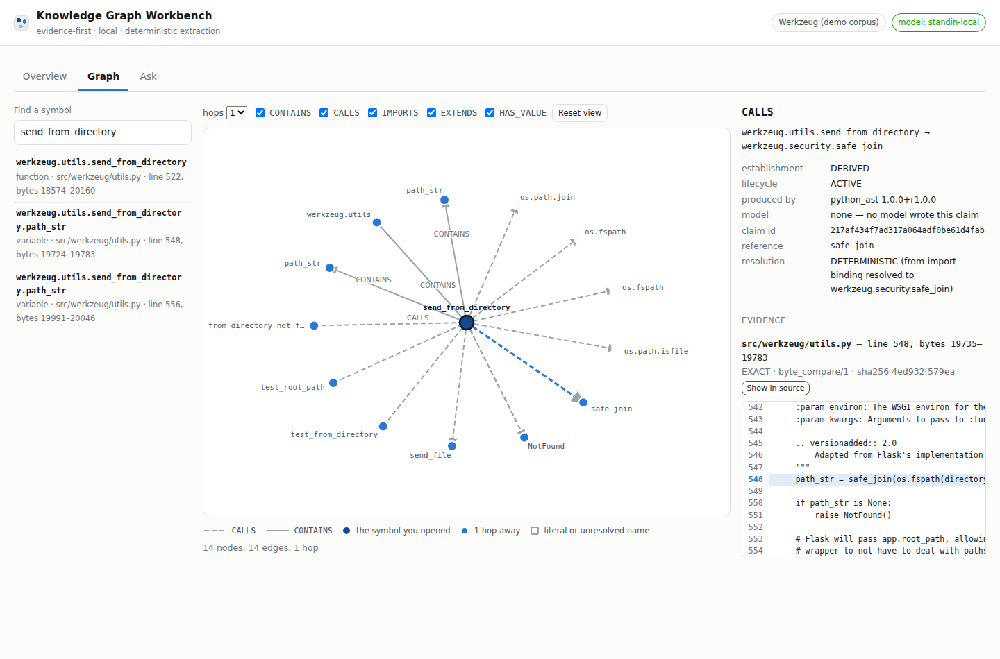
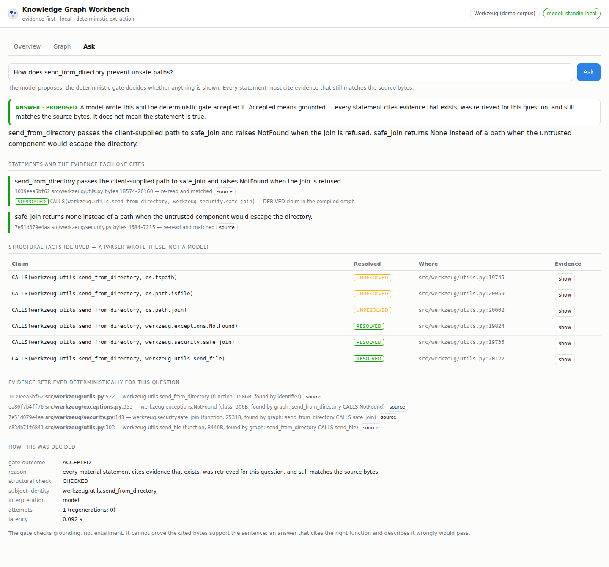
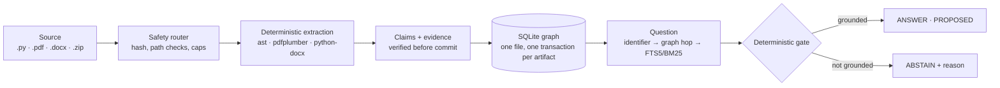

# Evidence-first Universal Knowledge Graph Compiler

**Intelligence you can inspect.**

A deterministic-first, local-first compiler that turns Python code, PDFs and DOCX
files into a SQLite knowledge graph. Every structural claim in the graph carries
evidence that points back to the exact bytes, page or paragraph it came from,
and that evidence is re-checked against the source on disk. A language model is
optional. It can propose an answer to a question, but it cannot write a
structural fact into the graph.

## Demo

[](media/evidence-first-film.mp4)

An 80-second product film. Click the poster to play it. Captions are in
[`media/evidence-first-film.srt`](media/evidence-first-film.srt). Every number,
claim id, byte range and source line in the film was read from a real compile of
the bundled Werkzeug corpus. The film is a separate Remotion project and is not part of this
repository.

| Click an edge, read the claim and the bytes behind it | A question answered with per-statement evidence |
|---|---|
|  |  |

More screenshots are in [`demo_0_2_screens/`](demo_0_2_screens/): the home page,
dark mode, the file-accounting table, and a PDF page shown without invented line
numbers.

---

## Why it exists

A common way to build a "knowledge graph over your code and documents" is to
have a language model read the sources and write the graph. The result looks authoritative, but you
cannot tell which edges the parser established and which the model made up, and
you cannot get from an edge back to the line that justifies it.

This project takes the opposite approach. The graph is *compiled* from the
structure of the sources by deterministic analysers. A model is used only at
question time, only over evidence the compiler already recorded, and its output
is labelled as a proposal.

## What makes it different

- **Provenance on every claim.** A claim cannot be inserted without at least one
  evidence row; SQLite triggers in [`kgc/store.py`](kgc/store.py) enforce this.
  Evidence stores the artifact's SHA-256, a typed locator and the quoted text.
  Verifying it means re-deriving that text from the file and comparing.
- **Deterministic facts outrank model facts.** Structural predicates (`CALLS`,
  `IMPORTS`, `EXTENDS`, `CONTAINS`, `HAS_VALUE`) may only be stored as `DERIVED`
  or `CONFIRMED`. A `DERIVED` claim must have no model id. A model answer is
  always `PROPOSED`, and it is shown next to the compiler's facts, never merged
  into them.
- **Unresolved is labelled, not guessed.** If the static resolver cannot bind a
  call target, the reference is stored as `UNRESOLVED` with a reason. It is not
  turned into a plausible-looking edge.
- **Source text is data, not instructions.** Nothing in the ingestion path
  executes or follows what a file says. The web UI inserts source content as
  text only. A test checks that a file containing "Ignore previous instructions"
  stays plain source content.
- **Every input file is accounted for.** Unsupported formats, symlinks, path
  traversal attempts, oversize files and syntax errors are recorded as artifacts
  with a status and a reason (`UNSUPPORTED`, `SKIPPED`, `FAILED`, `PARTIAL`).
  No file is silently dropped. After ingestion, a coverage check fails the run
  if any analysable file has no artifact row.
- **Abstention names its reason.** When the answer gate refuses, it says which
  check failed: no model configured, an ambiguous subject, a citation outside
  the retrieved set, or evidence that no longer matches the source. An answer
  that cannot be grounded is not shown.

---

## Quick start

Requires Python 3.11 or later. Tested here on 3.13.

### Workbench (browser)

```bash
pip install -r requirements.txt     # fastapi, uvicorn, python-multipart, pdfplumber, python-docx, reportlab
python3 -m kgq.web --port 8000      # serves http://127.0.0.1:8000 (use --host to change)
```

Open the page and click **Try Werkzeug** to compile the bundled Werkzeug corpus
(`eval/corpus3`), or upload a `.zip`, `.py`, `.pdf` or `.docx`. Each upload gets
its own workspace and SQLite file under `workspaces/`, which is gitignored.

### Command line

The compiler core and both CLIs use only the standard library (`ast`,
`sqlite3` with FTS5, `hashlib`, `urllib`). The packages in `requirements.txt`
are needed only for the web workbench, the PDF/DOCX analysers and the test
fixtures. `kgq compile` and `kgq ask --no-llm` were run on Werkzeug with
`fastapi`, `pdfplumber`, `docx` and `reportlab` blocked from import, and both
worked.

```bash
# Compile a source tree into a fresh SQLite graph (an existing --db file is deleted first)
python3 -m kgq.cli compile --root eval/corpus3 --db /tmp/werkzeug.sqlite

# Ask a question using only the deterministic half: retrieval and structural facts, no model
python3 -m kgq.cli ask "How does send_from_directory prevent unsafe paths?" \
    --db /tmp/werkzeug.sqlite --root eval/corpus3 --no-llm

# Inspect the graph with the compiler CLI
python3 -m kgc.cli stats  --db /tmp/werkzeug.sqlite      # row counts, parse status, resolution split
python3 -m kgc.cli verify --db /tmp/werkzeug.sqlite      # independent invariant audit; exits 1 on any violation
python3 -m kgc.cli show   --db /tmp/werkzeug.sqlite werkzeug.utils.send_from_directory
python3 -m kgc.cli diagnostics --db /tmp/werkzeug.sqlite --code UNSUPPORTED_LANGUAGE
```

| Command | Flags |
|---|---|
| `kgq.cli compile` | `--root ROOT --db DB` |
| `kgq.cli ask QUESTION` | `--db DB --root ROOT [--no-llm] [--json] [--html PATH] [--cache CACHE] [--max-context-chars N] [--answer-attempts N] [--no-colour]` |
| `kgc.cli ingest ROOT` | `--db DB [--no-resume]` (resumes an interrupted run by default) |
| `kgc.cli stats` / `verify` | `--db DB` |
| `kgc.cli show QUALIFIED_NAME` | `--db DB` |
| `kgc.cli diagnostics` | `--db DB [--code CODE]` |
| `kgq.web` | `[--host HOST] [--port PORT]` (defaults `127.0.0.1:8000`) |

`kgq ask` exits `0` when it shows an answer and `2` when it abstains, so you can
use it in scripts.

### Optional: a model for semantic answers

The model interface is a single OpenAI-compatible `/chat/completions` client
([`kgq/provider.py`](kgq/provider.py)), written with `urllib` only and no SDK.
It is configured entirely through environment variables:

| Variable | Purpose |
|---|---|
| `KGQ_BASE_URL` | endpoint base, for example a local Ollama at `http://localhost:11434/v1`, or Groq / OpenRouter |
| `KGQ_MODEL` | the model name that endpoint expects |
| `KGQ_API_KEY` | sent as a bearer token; leave unset for a local model |

If these are not set, `ask` still shows the retrieved evidence and the
deterministic facts, and abstains from the semantic answer. Responses are cached
by content hash (`--cache`). Model weights carry their own licences, and you are
responsible for checking the licence of any model you use.

---

## How it works



1. **Route.** Walk the tree, hash every file, and refuse unsafe paths,
   symlinks, oversize files and binaries pretending to be text. Each refusal is
   recorded.
2. **Extract (stage 1).** Python goes through the stdlib `ast`. PDFs go through
   `pdfplumber`, where each page becomes a symbol. DOCX goes through
   `python-docx`, where paragraphs and tables become symbols. Each artifact is
   committed in its own transaction, so an interrupted run resumes from its
   work queue.
3. **Resolve (stage 2).** References are resolved against the corpus-wide
   symbol table, including re-exports. Each one is marked `DETERMINISTIC`,
   `HEURISTIC` or `UNRESOLVED`, and the reason is stored.
4. **Claim + evidence.** Each structural fact is a claim with at least one
   evidence row. The evidence is verified against the artifact bytes before the
   claim is written.
5. **Ask.** Retrieval returns existing evidence ids and never mints new ones. A
   model, if configured, may cite only those ids. The deterministic validator
   re-reads every cited span from disk and checks structural assertions against
   the graph. The result is either `ANSWER` (always `PROPOSED`) or an abstention
   with its reason.

### Data model essentials

The full schema is in [`kgc/store.py`](kgc/store.py). The design rationale is
in [DATA_MODEL.md](DATA_MODEL.md) and [ADR/0006](ADR/0006-claim-lifecycle-and-verification.md).

| Concept | What it is |
|---|---|
| **artifact** | One input file: path, SHA-256, size, `parse_status` (`OK`, `PARTIAL`, `FAILED`, `SKIPPED`, `UNSUPPORTED`) and the reason for a non-OK status. |
| **symbol** | A lexical unit with an occurrence-scoped identity: a module, class, function, method, variable or constant; a PDF page; a DOCX paragraph or table. |
| **claim** | `(subject, predicate, object or literal)` with a `lifecycle` and an `establishment`. |
| **establishment** | `DERIVED` (proved by a deterministic analyser), `CONFIRMED` (proposed by a model, then independently re-derived), `PROPOSED` (from a model, stored but never a trusted answer), `DISPUTED`. Only `DERIVED`/`CONFIRMED` can support an answer. |
| **evidence** | Artifact hash, typed locator, `quoted_text` and `verification_strength`: `EXACT` (byte or AST re-derivation; all Python evidence) or `REPRODUCIBLE` (a pinned extractor re-run; PDF/DOCX text). |
| **reference** | The resolution record for a `CALLS`/`IMPORTS`/`EXTENDS` target: `DETERMINISTIC`, `HEURISTIC` or `UNRESOLVED`, with the reason. |
| **diagnostic** | Every parse failure, unsupported file, refusal and dropped edge, with a code and a message. |

`confidence` does not affect any decision. The support gate never reads it,
and a test assigns 0.97 to an untrusted claim to check that the claim is still
refused.

---

## Capabilities

Each "Implemented" entry below was checked against the code, not only against
the design documents.

| Area | Implemented | Not yet |
|---|---|---|
| **Python** | stdlib `ast`: modules, classes, functions, methods, constants, docstrings; byte range + line/col for every symbol | Other languages |
| **Predicates emitted** | `CONTAINS`, `CALLS`, `IMPORTS`, `EXTENDS`, `HAS_VALUE` (class-body literal assignment) | `DEFINES`, `READS`, `WRITES`, `HAS_DEFAULT`, `HAS_TYPE`, `HAS_PURPOSE` are defined in [`kgc/predicates.py`](kgc/predicates.py) but not emitted |
| **Resolution** | Cross-module resolution through the import graph and re-exports; unresolved targets stored with a reason | Dynamic dispatch, `getattr`, monkey-patching, method calls on runtime objects |
| **Evidence** | Typed verifiers: byte compare and AST re-parse (`EXACT`); PDF/DOCX re-extraction (`REPRODUCIBLE`); content drift detected through the SHA-256 | |
| **PDF** | `pdfplumber`: each page is a symbol with real page numbers; pages without text are reported as `PARTIAL` | OCR (deliberately absent); bbox-level highlighting in the UI |
| **DOCX** | `python-docx`: paragraphs and tables, addressed by index. No page numbers are produced, because the file format does not store them | |
| **Retrieval** | Exact identifier lookup, one-hop expansion along resolved `CALLS`, SQLite FTS5/BM25 fallback. No embeddings, no vector store | Dense or semantic retrieval |
| **Graph view** | Local neighbourhood of 1 to 2 hops, capped at 220 nodes with truncation announced; predicate toggles; edge → claim → evidence → source | Whole-graph or analytical views |
| **Workbench** | FastAPI with vanilla HTML/CSS/JS and no build step; light and dark themes; upload, compile progress, dashboard, graph, evidence, ask | Multi-user, authentication |
| **Safe ZIP upload** | Rejects `..`, absolute paths, drive letters and symlink members; caps on archive size, expanded size, member size and file count; every refusal reported | |
| **Workspaces** | One directory and one SQLite file per upload; forged ids refused; delete is safe even through a symlinked corpus | |
| **Diagnostics** | `kgc diagnostics`, the dashboard's "files that did not produce a graph" table, and `kgc verify` invariant audit | |
| **Resumable ingestion** | Work queue in SQLite, one transaction per artifact, crash-point tests, quarantine after 3 attempts; `--no-resume` to start over | |
| **LLM provider** | One OpenAI-compatible client (local Ollama, Groq, OpenRouter, ...) using `KGQ_BASE_URL`, `KGQ_MODEL` and `KGQ_API_KEY`; content-addressed response cache; usage accounting | Native non-OpenAI-shaped adapters; a validated hosted-model run |
| **Answer gate** | Cited ids must exist and must be in the retrieved set; spans re-read from disk; structural assertions checked as `SUPPORTED`, `EXPLICIT_CONTRADICTION` (closed-world predicates only) or `NOT_ESTABLISHED`; one regeneration, then abstain | Entailment checking |
| **Abstention** | `ABSTAIN` with the failing reason; `ABSTAIN_AMBIGUOUS` lists the candidate entities | |

### Roadmap

- More source languages beyond Python.
- SQL schema and data lineage.
- OCR for scanned PDFs, as an opt-in extra.
- Semantic entity extraction and cross-source linking (code ↔ design doc ↔
  discussion), held to the same claim and evidence rules.
- J-2: measuring whether grounded answers are actually *correct*, using an
  independently authored query set against a real hosted model. See
  [`eval/j2/`](eval/j2/).

---

## Benchmark: Werkzeug

This is one recorded run on the bundled Werkzeug corpus (`eval/corpus3`,
Pallets, BSD-3-Clause, pinned commit). It is not a performance guarantee.

| | |
|---|---|
| Files (artifacts) | 225 (140 parsed `OK`, 85 recorded as `UNSUPPORTED`: `.rst`, `.html`, `.toml`, ...) |
| Symbols | 6,102 |
| Claims | 16,244 (all `DERIVED`) |
| Evidence records | 16,066 (all `EXACT`) |
| Compile time | about 6 s according to [DEMO_0_2.md](DEMO_0_2.md); a re-run while writing this README took about 5 s |
| Invariant audit | `OK: all invariants hold` |

**References: 2,113 resolved (1,405 deterministic + 708 heuristic) and 8,007
unresolved.** The unresolved majority is expected for this kind of code:

- Calls into the standard library and third-party modules that are not in the
  corpus, such as `os`, `re`, `typing`, `warnings` and `pytest`. These are out of
  scope by definition.
- Builtins such as `len`, `isinstance` and `super`.
- Method calls on runtime objects (`adapter.match`, `self.storage_class`,
  `environ.get`) and computed calls. Resolving these requires type inference or
  dynamic dispatch, which the resolver does not attempt.

Each unresolved reference keeps its reason (`kgc stats`, `kgc diagnostics`).
A missing `CALLS` edge is treated as information about the compiler, not about
the code: `CALLS` is open-world, so an absent edge can never be used to
contradict anything.

On the flagship question, *"How does send_from_directory prevent unsafe
paths?"*, retrieval returns `send_from_directory` (`utils.py:522`), `NotFound`,
`safe_join` and `send_file`. Six `DERIVED` `CALLS` facts are shown alongside:
three resolved, and three stdlib calls (`os.fspath`, `os.path.join`,
`os.path.isfile`) labelled as unresolved.

---

## Limitations

- **Grounding is not entailment.** The gate proves that every cited span exists,
  was retrieved for this question, and still matches the source bytes. It cannot
  prove that those bytes support the sentence. An answer that cites the right
  function and describes it wrongly passes every check. The UI prints this
  warning under every answer.
- **No live hosted model has been exercised.** In the environments where this
  was built, every hosted provider was blocked at the network layer. The
  transport is tested against a local OpenAI-compatible server, and the answer
  rendering was demonstrated with a scripted stand-in that is not a language
  model. Answer quality is unmeasured, and J-2 is blocked
  ([`eval/j2/J2_BLOCKED.md`](eval/j2/J2_BLOCKED.md)).
- **Dynamic behaviour is not resolved.** Dynamic dispatch, `getattr`,
  monkey-patching and decorators that rewrite calls are blind spots. They are
  recorded as unresolved, not inferred.
- **Ambiguity costs availability.** A bare name such as `Response` that matches
  several entities is refused as ambiguous until it is qualified.
- **The graph view is a local picture.** It shows a one- or two-hop neighbourhood
  and is good for tracing provenance, not yet for discovering structure.
- **Only the author has used it.** All usability claims so far come from
  sessions run by the person who wrote the code.

---

## Tests

```bash
pip install -r requirements.txt   # reportlab builds real PDF/DOCX fixtures
python3 -m pytest -q tests
```

Run against `tests/`. A bare `pytest` from the repo root also collects
Werkzeug's own test suite in `eval/corpus3`, which needs extra dependencies.

On the run made while writing this README: **271 passed, 97 subtests passed, in
about 8 s.** [DEMO_0_2.md](DEMO_0_2.md) records 270, so one test has been added
since that document was written. The tests cover ingestion integrity and
resume, crash points, occurrence identity, predicate semantics, `HAS_VALUE`,
the trust boundary, provider transport over real HTTP, ZIP safety, workspace
isolation, PDF/DOCX upload, the graph and answer APIs, and prompt-injection
content.

---

## Repository map

| Path | Contents |
|---|---|
| [`kgc/`](kgc/) | The compiler. `pipeline.py` (two-stage resumable ingest), `store.py` (SQLite schema and invariant triggers), `evidence.py` (typed verifiers), `safety.py` (ingestion security boundary), `predicates.py` (canonical vocabulary and trust rules), `cli.py` |
| [`kgc/analysis/`](kgc/analysis/) | `python_backend.py` (AST analyser), `document.py` (PDF/DOCX adapters), `resolver.py` (cross-module resolution), `mapper.py` (analysis → symbols, claims, evidence) |
| [`kgq/`](kgq/) | The query side. `retrieval.py`, `answer.py`, `validate.py` (deterministic gate), `contract.py`, `provider.py`, `graph.py`, `workspace.py` (safe uploads), `web.py` + `web_static/` (workbench), `cli.py` |
| [`tests/`](tests/) | The test suite |
| [`eval/`](eval/) | Evaluation corpora (`corpus3` is Werkzeug), gold sets, J-1/J-2 query sets and harnesses |
| [`experiments/`](experiments/) | Measurement scripts and recorded results for each gate (retrieval, abstention, generalization, integrity audits) |
| [`bench/`](bench/) | Gate 1 ingestion baseline measurements on synthetic corpora, and their results |
| [`ADR/`](ADR/) | Architecture decision records 0001 to 0007: boundaries, IR, provider, storage, code analysis, claim lifecycle, bounded retrieval |
| [`demo_0_2_screens/`](demo_0_2_screens/) | Workbench screenshots |
| [PROJECT_SPEC.md](PROJECT_SPEC.md) | Goals, non-negotiable constraints, the deterministic-versus-LLM decision matrix |
| [ARCHITECTURE.md](ARCHITECTURE.md) | Pipeline, the single-SQLite storage decision, evidence anchors per modality |
| [DATA_MODEL.md](DATA_MODEL.md) | Design-time data model and locator shapes |
| [CLAIM_SEMANTICS.md](CLAIM_SEMANTICS.md) | Predicate audit, cardinality, property-word mapping |
| [CLAIM_TRUST_BOUNDARY.md](CLAIM_TRUST_BOUNDARY.md) | The eleven support invariants and what may and may not influence a decision |
| [ABSTENTION_DESIGN.md](ABSTENTION_DESIGN.md) | Design of the support and abstention gate |
| [DEMO_0_1.md](DEMO_0_1.md), [DEMO_0_2.md](DEMO_0_2.md) | Demo write-ups: CLI answers, then the workbench |
| `GATE_*_REPORT.md`, `J1_*`, `K1_*` | Gate-by-gate reports, including failures and the fixes for them |
| [RISK_REGISTER.md](RISK_REGISTER.md), [LICENSE_AUDIT.md](LICENSE_AUDIT.md) | Risks with mitigations; dependency licence audit |

---

## License

**This repository does not include a `LICENSE` file yet.** Until the owner adds
one, no open-source licence has been granted. [LICENSE_AUDIT.md](LICENSE_AUDIT.md)
*recommends* Apache-2.0 and records that the choice belongs to the repository
owner. All required dependencies are permissively licensed (MIT, Apache-2.0,
BSD, PSF, public domain). PyMuPDF was rejected because it is AGPL. The bundled
evaluation corpora keep their upstream licences; for example, `eval/corpus3` is
Werkzeug under BSD-3-Clause.
